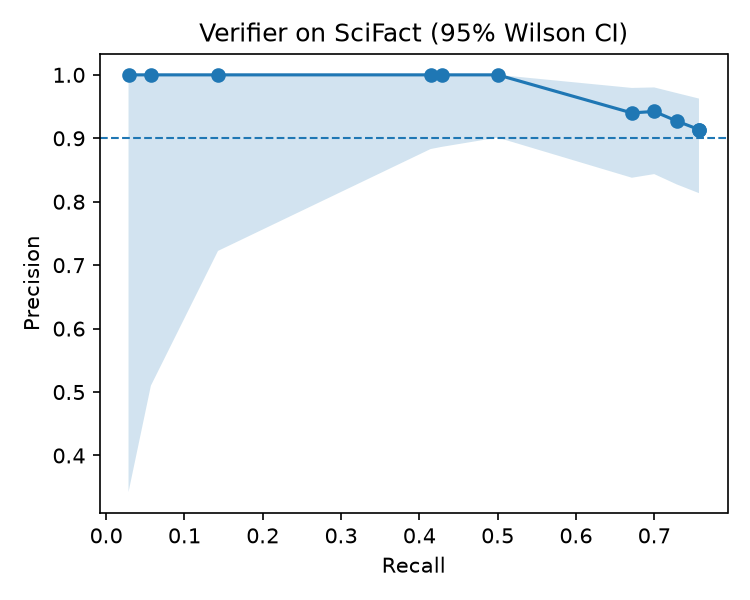

# Referee



Referee checks your writing against the sources you have read. A browser extension quietly
captures the articles you read while researching, and as you write, each finished sentence is
checked against that reading. Supported claims are shown with the exact quote that backs them,
and Referee warns you when a source says the opposite, when a quotation doesn't match its
source, or when wording has been copied without quotation marks.

It never writes for you. It only checks, credits and warns.

Built in one day for the Invisible AI hackathon on 10 October 2026, where the brief was AI
that works inside what you're already doing rather than something you have to prompt.

---

## Contents

1. [What it does](#1-what-it-does)
2. [How it works](#2-how-it-works)
3. [Data and models](#3-data-and-models)
4. [Validation](#4-validation)
5. [Limitations](#5-limitations)
6. [Cut features](#6-cut-features)
7. [Repository layout](#7-repository-layout)
8. [Running it](#8-running-it)
9. [Future updates](#9-future-updates)
10. [References and acknowledgements](#10-references-and-acknowledgements)
11. [Team](#11-team)

---

## 1. What it does

**While you research.** Articles are captured only while research mode is on. In automatic
mode it switches on when you start writing, and a timer switches it off again. Banking,
payment, login and account pages, email, social media, search results and writing tools are
never captured, nor is any page with a password box. Before a page leaves the browser tab,
every form field, text box and script is removed, so nothing anyone typed is sent.

**While you write.** Each sentence is checked when it is finished.

| marker | meaning |
|---|---|
| supported | a source you read backs this claim, shown with the exact supporting quote |
| contradicted | a source you read says the opposite, or a much weaker version, of the claim |
| misquote | text in quotation marks doesn't match the source word for word |
| too close | wording copied from a source without quotation marks |

If nothing you read relates to a sentence, Referee stays silent rather than guessing.

**It learns from behaviour.** Dismissing a marker or opening its source is recorded, and
Referee learns which kinds of marker each person finds useful, then stops showing the ones
they keep rejecting. There is nothing to configure.

## 2. How it works

**Capture.** The extension sends each article page to a local backend, which extracts the
article text with trafilatura, strips references and citation clutter, and splits it into
short overlapping passages.

**Search.** Passages are embedded with a small sentence-transformer model that runs on your own
machine. A finished sentence is embedded the same way, and the five closest passages by cosine
similarity are taken forward, provided they clear a minimum similarity.

**Verify.** Claude decides whether any of those passages supports or contradicts the specific
claim, or neither. Being on the same topic is not support, and the strength of a claim counts,
so "strongly linked" is contradicted by a source that finds only a weak link. The reply is
constrained to a fixed schema with structured outputs, and the quote it returns must appear
word for word in the passage, otherwise nothing is shown.

**Wording checks.** Quotations are compared with the source, treating `...` and `[insertions]`
as gaps. Unquoted text is checked for copied wording by the share of its 3-word runs found in
the passage, ignoring runs that recur across four or more sentences of the reading, since those
are the topic's standard phrasing rather than copying.

**Learning.** Behaviour events become labelled examples, with explicit actions weighted fully
and implicit ones such as ignoring a marker weighted at 0.3. A logistic regression on verifier
confidence, search similarity and marker type is refitted after every event. Until there are
enough events to cover both outcomes, every marker the verifier accepts is shown, so the
evaluated threshold acts as the prior.

Only the sentence being checked and its closest passages are sent to Claude. The reading itself
stays on your machine.

## 3. Data and models

| source | use |
|---|---|
| [SciFact](https://github.com/allenai/scifact) | 1,409 scientific claims with labelled evidence from 5,183 abstracts, used to evaluate the verifier |
| [trafilatura](https://github.com/adbar/trafilatura) | article text extraction from captured pages |
| [all-MiniLM-L6-v2](https://huggingface.co/sentence-transformers/all-MiniLM-L6-v2) | local sentence embeddings for search |
| [Claude Haiku 5.5](https://www.anthropic.com/claude) | claim verification, through the Anthropic API |
| Wikipedia, NHS and BBC pages | captured during development and used for the wording calibration |

SciFact is not committed to this repository. The evaluation script expects it in `~/scifact/data`.

## 4. Validation

Every figure in this section is reproduced by `eval_scifact.py` and `eval_wording.py` in `server/`.

### Claim verification

100 claim and evidence pairs were drawn from the SciFact development set: 40 supporting, 30
contradicting, 15 claims paired with an abstract they cite but that doesn't address them, and 15
claims paired with sentences from their own evidence abstract that aren't the evidence. The last
group is the hard case, same topic and same paper but no support.

The verifier was run on every pair with its threshold switched off, then scored at each
confidence level. A marker counts as shown when the verdict is supported or contradicted at or
above the threshold.

| threshold | precision | 95% CI | recall | markers shown |
|---:|---:|---:|---:|---:|
| 0.60 | 0.91 | 0.81–0.96 | 0.76 | 58 |
| 0.75 | 0.94 | 0.84–0.98 | 0.70 | 52 |
| 0.85 | 1.00 | 0.90–1.00 | 0.50 | 35 |

Intervals are Wilson score intervals. The threshold of 0.6 is the lowest that keeps precision at
or above 0.9, which gives the most recall at a trustworthy precision.

| | contradicts | neutral | supports |
|---|---:|---:|---:|
| contradicts | 26 | 4 | 0 |
| neutral | 3 | 26 | 1 |
| supports | 1 | 12 | 27 |

Rows are the true label and columns the verdict, before any threshold. Most errors are missed
support rather than false support, which is the safer way for a citation tool to be wrong.
3 of the 15 hard negatives were marked.

An earlier run with the first version of the prompt gave a precision of 0.95 (0.86–0.98). The
two runs sit inside each other's intervals, which is consistent with run-to-run variation in the
model's answers rather than a real difference between the prompts.

### Copying detection

21 sentences were written against five passages from the captured Wikipedia article on the
Mediterranean diet: copies, light edits, paraphrases and sentences in the writer's own words.
The check should flag the first two and not the last two. A grid over run length, stock-phrase
threshold and cut-off finds the setting with the widest gap between them.

| setting | margin |
|---|---:|
| word-run overlap only | 0.06 |
| ignoring stock phrases | 0.32 |

Ignoring the topic's standard phrasing widened the margin more than five times. The chosen
setting is 3-word runs, stock phrases appearing in 4 or more sentences, and a cut-off of 0.30.

## 5. Limitations

**The intervals are wide.** 100 pairs gives a precision interval of roughly 81% to 96%. At the
low end, about one marker in five would be wrong.

**Answers vary between runs.** The model doesn't accept a sampling temperature, so the same
sentence can occasionally get a different verdict. The evaluation measures behaviour across many
cases rather than relying on any single answer.

**SciFact is not the web.** The benchmark is scientific abstracts. Everyday articles may behave
differently, and that hasn't been tested yet.

**The copying calibration is small.** 21 hand-written sentences from one article. It is a
sensible setting, not a benchmark.

**Only double quotation marks are read as quotes.** Single quotes are skipped because they look
the same as apostrophes, and square brackets inside a quote are accepted as edits without
checking what they replace.

**Only web pages are captured.** PDFs, where many academic papers are read, aren't supported.

**Author metadata is unreliable.** Many pages don't publish a usable author, so the
organisation is used instead.

**Learning starts from very little.** With only a handful of events the model is easily swayed,
which is why it falls back to the evaluated threshold until it has seen both outcomes.

**The skip list is a list.** It covers major banks, payment, login and account pages, but it
can't name every private site. The password-box rule catches most of the rest.

## 6. Cut features

**Plain overlap for copying.** Measuring copied word runs alone flagged sentences written in the
writer's own words, because a topic's stock phrasing appears everywhere. Replaced by the
stock-phrase filter.

**Longer word runs.** 4, 5 and 6-word runs were tested as a fix for the same problem. None
separated copying from own words once a real stock phrase was included, so the run length wasn't
the cause.

**Three search candidates.** Searching for three passages missed the best one in testing, and
the verifier then judged a weaker passage. Five candidates fixed it.

**A two-label verifier.** Supports or not was replaced by supports, contradicts or neutral, so a
source that says the opposite can be flagged instead of ignored.

**Fetching pages on the server.** Fetching a URL from the backend hits paywalls. Capturing the
page as the reader sees it in the browser includes articles they're logged in to.

## 7. Repository layout

```
├── server/                     backend, runs locally
│   ├── main.py                 API routes
│   ├── extract.py              article text and passages
│   ├── embeddings.py           local sentence embeddings
│   ├── store.py                passage storage and similarity search
│   ├── verify.py               claim verification, quote and copying checks
│   ├── feedback.py             learns which markers each person finds useful
│   ├── eval_scifact.py         verifier evaluation on SciFact
│   ├── eval_wording.py         copying detection calibration
│   ├── load_demo.py            preloads demo sources
│   └── requirements.txt
│
├── extension/                  Chrome extension
│   ├── manifest.json
│   ├── background.js           talks to the backend, runs research mode
│   ├── content.js              captures article pages
│   ├── popup/                  research mode, timer, automatic or manual
│   ├── editor/                 writing page with source cards
│   └── icons/
│
├── word-addin/                 Word add-in, in development
│
├── images/                     figures
├── README.md
└── .gitignore
```

## 8. Running it

```bash
python3 -m venv .venv
source .venv/bin/activate
pip install -r server/requirements.txt
```

Create `server/.env` with an Anthropic API key. Never commit this file.

```
ANTHROPIC_API_KEY=sk-ant-...
```

```bash
# start the backend (the first run downloads the embedding model)
cd server
uvicorn main:app --port 8000

# verifier and wording tests
python verify.py

# evaluation, needs pandas and matplotlib, and SciFact in ~/scifact/data
python eval_scifact.py build
python eval_scifact.py run
python eval_scifact.py analyse
python eval_wording.py
```

To load the extension, open `chrome://extensions`, turn on developer mode, choose
**Load unpacked** and select the `extension` folder. Switch on research mode, read some
articles, then open the editor from the popup and start writing.

## 9. Future updates

**v0.2.0, Word integration.** Bring Referee into Microsoft Word: checking sentences as you type,
and citations, sources and the bibliography handled through Word's own referencing tools, in
APA 7 or Harvard.

**v1.0.0, official release.** Clean up and document the verification and evaluation work, with
a Jupyter notebook covering the method and results. The evaluation would grow to several hundred
pairs with repeated runs to measure the model's variability, separate thresholds for supported
and contradicted markers, test pairs from everyday web articles, and a comparison with a larger
model and a free local one.

**Later.** Google Docs, PDF capture, captured reading that expires after a set number of days,
and a provenance log that records your research process, as evidence of your own work when
AI-writing detectors get it wrong.

## 10. References and acknowledgements

Wadden, D., Lin, S., Lo, K., Wang, L. L., van Zuylen, M., Cohan, A., & Hajishirzi, H. (2020).
Fact or fiction: Verifying scientific claims. In *Proceedings of the 2020 Conference on
Empirical Methods in Natural Language Processing* (pp. 7534–7550).
https://doi.org/10.18653/v1/2020.emnlp-main.609

Reimers, N., & Gurevych, I. (2019). Sentence-BERT: Sentence embeddings using Siamese BERT-networks.
In *Proceedings of the 2019 Conference on Empirical Methods in Natural Language Processing*
(pp. 3982–3992). https://doi.org/10.18653/v1/D19-1410

Wilson, E. B. (1927). Probable inference, the law of succession, and statistical inference.
*Journal of the American Statistical Association*, *22*(158), 209–212.
https://doi.org/10.1080/01621459.1927.10502953

Barbaresi, A. (2021). Trafilatura: A web scraping library and command-line tool for text
discovery and extraction. In *Proceedings of the Joint Conference of the 59th Annual Meeting of
the ACL and the 11th IJCNLP: System Demonstrations* (pp. 122–131).
https://doi.org/10.18653/v1/2021.acl-demo.15

## 11. Team

- [sedmoh](https://github.com/sedmoh): the browser extension, and the backend's page
  extraction, embeddings, storage, search and API.
- [reeceama](https://github.com/reeceama): claim verification, evaluation and calibration,
  misquote and copying detection, the learning model, the Word add-in, and the browser
  extension's privacy features.
