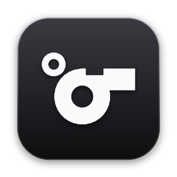

<p align="center"></p>

<h1 align="center">Referee</h1>

Referee checks your writing against the sources you have read. You add the articles, PDFs and YouTube videos you'll cite, or a browser extension collects what you read while researching, and as you write in Word, each finished sentence is checked against that reading. Supported claims are shown with the exact quote that backs them, and Referee warns you when a source says the opposite, when a quotation doesn't match its source, or when wording has been copied without quotation marks.

It never writes for you. It only checks, credits and warns.

Built in one day for the Invisible AI hackathon on 10 October 2026, where the brief was AI that works inside what you're already doing rather than something you have to prompt.

## Download

**[Download Referee for Mac](https://github.com/reeceama/Referee/releases/latest/download/Referee-mac.zip)** (Apple silicon, macOS 14 or later). Everything it needs is inside the app.

1. Open the zip and drag **Referee** into Applications.
2. Open it. The first time, macOS says it can't check the developer, because the app isn't notarised by Apple: go to **System Settings → Privacy & Security** and click **Open Anyway**. You only do this once.
3. In Referee's settings, paste your [Anthropic API key](https://console.anthropic.com). It's kept in your Keychain.
4. Add the sources you'll cite with **Add Source…** in the menu bar, or choose **Install Browser Extension…** to collect what you read automatically.

Referee checks your writing as you type in Word, and updates itself when a new release comes out. There's no Windows app yet; Windows users can run it from the code (see [Running it](#6-running-it)).

## Team members

- Reece Mings-Alleyne ([GitHub](https://github.com/reeceama) / [LinkedIn](https://www.linkedin.com/in/reece-mings-alleyne/))
- sedmoh ([GitHub](https://github.com/sedmoh))

## Contents

1. [What it does](#1-what-it-does)
2. [How it works](#2-how-it-works)
3. [Data and models](#3-data-and-models)
4. [Validation](#4-validation)
5. [Repository layout](#5-repository-layout)
6. [Running it](#6-running-it)
7. [API](#7-api)
8. [License](#8-license)

## 1. What it does

**While you research.** Pages are captured only once you've actually read them: a page counts after it has been open and visible for 20 seconds, or as soon as you highlight text on it. Pages you bounce off aren't kept. PDFs are captured with their page numbers, and YouTube videos through their transcripts, with timestamps. By default the extension captures only while you're writing in Word (and for five minutes after), or while research mode is on: switched on from the menu bar or the popup, or by a macOS Focus once two Shortcuts automations are set up (see [Running it](#6-running-it)). Sources can also be added by hand with **Add Source** in the menu bar: a link to a page, PDF or YouTube video, or a PDF on your Mac.

Captured reading is temporary: it can be cited straight away, and is forgotten after 15 minutes (or an hour, or a day) unless you keep it. **Save for later** in the extension's popup keeps the page you're on, whether or not it was captured; sources added by hand are kept straight away, and any source your writing cites is kept automatically. Kept sources belong to the current project, chosen or created from the menu bar, the library or the popup. Projects are kept apart: writing is only checked against its own project's sources, plus any other projects you link it to in the library, where sources can also be moved between projects. The extension never runs in private (Incognito) windows. The library lists your reading, saved or temporary, and lets you save, move or forget any source.

Banking, payment, login and account pages, email, social media, search results and writing tools are never captured, nor is any page with a password box. Before a page leaves the browser tab, every form field, text box and script is removed, so nothing anyone typed is sent.

**While you write.** Each sentence is checked when it is finished, whether or not research mode is on. Research mode controls what is captured; anything already captured can be checked against at any time.

| Marker | Meaning |
|---|---|
| Supported | A source you read backs this claim, shown with the exact supporting quote. |
| Contradicted | A source you read says the opposite, or a much weaker version, of the claim. |
| Misquote | Text in quotation marks doesn't match the source word for word. |
| Too close | Wording copied from a source without quotation marks. |
| Needs a source | Reads like a factual claim, but nothing you read supports it. The closest sources you've read are suggested as places to look. |

Referee also warns when a figure in the sentence isn't in the source, shows exactly which words of a misquote differ, note when another source you read points the other way, when a claim only holds by combining two sources, and when a supporting source is more than ten years old. The library summarises how many claims your reading backs, and flags leaning heavily on one source.

In Word, the background Word helper (macOS and Windows) checks as you type with no add-in or panel: supported claims are marked and cited, a reference list is kept at the end, and warnings become comments (and are listed in the library). Sentences are marked with coloured underlines (green supported, amber check the wording, red contradicted), or highlights, or nothing, as chosen in settings; **Remove Marks in Word** in the menu bar clears Referee's marks, leaving your own. The library, a window in Referee for Mac (and a page in the extension), lists everything you've read, manages projects, and gives the reference list for what you've cited in APA 7, Harvard, MLA 9, IEEE or AMS, with page numbers for PDFs and timestamps for videos. Its proof-of-work report lists what you read, when, and which claims it backs.

If a sentence makes no claim and nothing you read relates to it, Referee stays silent rather than guessing.

**Learning from behaviour (not yet active in Word).** The server can learn which kinds of marker a person finds useful from what they do with them, such as dismissing a marker or opening its source, and stop showing the ones they keep rejecting. The Word helper doesn't report those actions yet, so in everyday use every marker the verifier accepts is shown.

## 2. How it works

```
Browser extension, Add Source ──capture──▶ Backend (your laptop) ◀──check── Word
                                │
                                ├─ extract.py    article text → overlapping passages
                                ├─ pdf.py        PDF text, with page numbers
                                ├─ video.py      YouTube transcripts, with timestamps
                                ├─ embeddings.py passages → vectors (runs locally)
                                ├─ store.py      saved to disk; meaning and keyword search
                                ├─ claims.py     does an unsupported sentence need a source?
                                ├─ verify.py     Claude: supports / contradicts / neutral,
                                │                plus quote and copying checks
                                └─ feedback.py   learns which markers each person finds useful
```

**Capture.** The extension sends each article page to a local backend (or Add Source fetches a page, PDF or video by its link), which extracts the article text with trafilatura, strips references and citation clutter, and splits it into short overlapping passages.

**Search.** Passages are embedded with a small sentence-embedding model that runs on your own machine. A finished sentence is embedded the same way and compared by cosine similarity, and a BM25 keyword search runs alongside it, since meaning-based search can blur exact names and figures. The two rankings are combined by reciprocal rank fusion, and the top five passages are taken forward, provided they clear a minimum similarity. If none do, nothing is sent anywhere.

**Verify.** Claude decides whether any of those passages supports or contradicts the specific claim, or neither. Being on the same topic is not support, and the strength of a claim counts, so "strongly linked" is contradicted by a source that finds only a weak link. The reply is constrained to a fixed schema with structured outputs. The quote it returns must be at least four words and appear in the passage (ignoring differences in spacing, capitals and curly quotes), otherwise nothing is shown. Calls time out after 10 seconds, and failures are logged. Verdicts are cached, so re-checking the same sentence against the same passages costs nothing.

**Wording checks.** Quotations are compared with the source, treating `...` and `[insertions]` as gaps. Unquoted text is checked for copied wording by the share of its 3-word runs found in the passage, ignoring runs that recur across four or more sentences of the reading, since those are stock phrasing rather than copying from one source.

**Learning.** Behaviour events become labelled examples, with explicit actions weighted fully and implicit ones weighted less. A logistic regression on verifier confidence, search similarity and marker type is refitted after every event. Until there are enough events to cover both outcomes, every marker the verifier accepts is shown, so the evaluated threshold acts as the prior.

**Privacy.** Only the sentence being checked and its closest passages are sent to Claude. The reading itself stays on your machine.

## 3. Data and models

| Source | Use |
|---|---|
| SciFact | 1,409 scientific claims with labelled evidence from 5,183 abstracts, used to evaluate the verifier |
| trafilatura | Article text extraction from captured pages |
| all-MiniLM-L6-v2 (ONNX) | Local sentence embeddings for search, run with ONNX Runtime |
| Claude Haiku 5.5 | Claim verification, through the Anthropic API |
| Wikipedia, NHS and BBC pages | Captured during development and used for the wording calibration |

SciFact is not committed to this repository. The evaluation script expects it in `~/scifact/data`.

## 4. Validation

Every figure in this section is reproduced by `eval_scifact.py` and `eval_wording.py` in `server/`.

### Claim verification

100 claim and evidence pairs were drawn from the SciFact development set: 40 supporting, 30 contradicting, 15 claims paired with an abstract they cite but that doesn't address them, and 15 claims paired with sentences from their own evidence abstract that aren't the evidence. The last group is the hard case: same topic, same paper, but no support.

The verifier was run on every pair with its threshold switched off, then scored at each confidence level. A marker counts as shown when the verdict is supported or contradicted at or above the threshold.

| Threshold | Precision | 95% CI | Recall | Markers shown |
|---|---|---|---|---|
| 0.60 | 0.93 | 0.83–0.97 | 0.76 | 57 |
| **0.70 (chosen)** | **0.96** | **0.87–0.99** | **0.70** | 51 |
| 0.80 | 0.98 | 0.88–1.00 | 0.63 | 45 |
| 0.85 | 1.00 | 0.89–1.00 | 0.46 | 32 |

Intervals are Wilson score intervals. To choose the threshold, a logistic regression of whether a marker was correct on the verifier's confidence was fitted by maximum likelihood, pooling this run with the previous one (117 markers). Treating a wrong marker as three times as costly as a missed one, a marker should be shown when it is at least 75% likely to be right, which the fit puts at a confidence of 0.68 (bootstrap 90% range 0.61–0.73). 0.7 is the nearest round value.

| True label ↓ / verdict → | contradicts | neutral | supports |
|---|---|---|---|
| contradicts | 24 | 6 | 0 |
| neutral | 3 | 27 | 0 |
| supports | 3 | 8 | 29 |

Verdicts before any threshold. Most errors are missed support rather than false support, which is the safer way for a citation tool to be wrong.

Earlier runs with previous versions of the prompt gave precisions of 0.91 and 0.95 at a threshold of 0.6. They sit inside each other's intervals, which is consistent with run-to-run variation in the model's answers rather than real differences between the prompts.

### Copying detection

21 sentences were written against five passages from the captured Wikipedia article on the Mediterranean diet: copies, light edits, paraphrases and sentences in the writer's own words. The check should flag the first two and not the last two. A grid over run length, stock-phrase threshold and cut-off finds the setting with the widest gap between them.

| Setting | Margin |
|---|---|
| Word-run overlap only | 0.06 |
| Ignoring stock phrases | 0.32 |

Ignoring stock phrasing widened the margin more than five times. The chosen setting is 3-word runs, stock phrases appearing in 4 or more sentences of the reading, and a cut-off of 0.30.

## 5. Repository layout

```
├── referee.py                  starts and watches the background parts (macOS and Windows)
├── tests/smoke_test.py         checks the background parts work, run by GitHub on Windows and macOS
├── server/                     backend, runs locally
│   ├── main.py                 API routes
│   ├── paths.py                where your data is kept (Application Support, or %LOCALAPPDATA%)
│   ├── api_key.py              your Anthropic API key, in Keychain or Credential Manager
│   ├── extract.py              article text and passages
│   ├── pdf.py                  PDF text and page numbers
│   ├── video.py                YouTube transcripts and timestamps
│   ├── embeddings.py           local sentence embeddings
│   ├── keywords.py             BM25 keyword search
│   ├── store.py                passage storage and search
│   ├── claims.py               does a sentence need a source?
│   ├── verify.py               claim verification, quote, figure and copying checks
│   ├── feedback.py             learns which markers each person finds useful
│   ├── claim_log.py            claims each source has backed, for the library
│   ├── reading.py              projects, and how long unsaved reading is kept
│   ├── citations.py            citation styles, for the Word helper and the library
│   ├── library.py              reference lists and the proof-of-work report
│   ├── eval_scifact.py         verifier evaluation on SciFact
│   ├── eval_wording.py         copying detection calibration
│   ├── load_demo.py            preloads demo sources
│   ├── .env.example            copy to .env and add your API key
│   └── requirements.txt
│
├── extension/                  Chrome extension
│   ├── manifest.json
│   ├── background.js           talks to the backend, runs research mode
│   ├── content.js              captures article pages once they've been read
│   ├── skip.js                 pages that are never captured
│   ├── popup/                  research mode, projects, captured reading
│   ├── library/                captured reading, references, proof of work
│   ├── dev/editor/             developer test page for checks (not user facing)
│   └── icons/
│
├── macapp/                     Referee for Mac: menu bar app, library, settings and updates
│   ├── Sources/                the app, in Swift
│   ├── build.sh                builds it from this folder into /Applications
│   ├── package.sh              builds the downloadable app, with its own Python
│   └── make_icon.py            draws the app and extension icons
├── word-helper/                background Word helper (AppleScript on macOS, COM on Windows)
├── scripts/install-windows.bat starts Referee at login on Windows
├── assets/                     README icon and link preview image
├── .github/workflows/test.yml  runs the tests on Windows and macOS after every push
│
├── README.md
├── LICENSE
└── .gitignore
```

## 6. Running it

```bash
python3 -m venv .venv
source .venv/bin/activate          # Windows: .venv\Scripts\activate
pip install -r server/requirements.txt
```

Add your Anthropic API key in Referee's settings (the Mac app, or the extension's library on any system). It's checked with Anthropic, then kept in your computer's password store (Keychain or Credential Manager). Alternatively, copy `server/.env.example` to `server/.env` and put the key there. Never commit that file.

```
ANTHROPIC_API_KEY=sk-ant-...
```

```bash
# start everything: the server and the Word helper. The first run downloads the embedding
# model (about 90 MB).
python referee.py

# or just the server
cd server
uvicorn main:app --port 8000

# verifier and wording tests
python verify.py

# evaluation: needs pandas and matplotlib, and SciFact in ~/scifact/data
python eval_scifact.py build
python eval_scifact.py run
python eval_scifact.py analyse
python eval_wording.py
```

On a Mac, `sh macapp/build.sh` builds **Referee.app** from this folder and installs it in `/Applications`; `sh macapp/package.sh 2026-10-12` builds the downloadable version instead, named for its release, with its own Python, code and libraries inside, as `macapp/dist/Referee-mac.zip` and its checksum (Apple silicon); publish both as a GitHub release of the same name, and downloaded copies update themselves. The app lives in the menu bar (a whistle: outlined when idle, filled while capturing) and runs the server and the Word helper while it's open. Its menu has research mode, the current project, the citation style in Word, Add Source, the library, Install Browser Extension and settings (API key, how long unsaved reading is kept, opening at login). On Windows, `scripts\install-windows.bat` starts the server and Word helper at login. `tests/smoke_test.py` checks the background parts work, without Word or an API key; GitHub runs it on Windows and macOS after every push. See `word-helper/README.md`.

To switch research mode on with a macOS Focus, create two automations in the Shortcuts app: when the Focus turns on, run the shell script `curl -s -X POST localhost:8000/focus -H 'Content-Type: application/json' -d '{"on":true}'`, and when it turns off, the same with `false`.

To load the extension, open `chrome://extensions`, turn on **Developer mode**, choose **Load unpacked** and select the `extension` folder. Start writing in Word and read some sources; anything you read while writing is captured. Open the library from the popup to see your reading and references. API docs are at http://localhost:8000/docs while the backend is running.

## 7. API

| Endpoint | Body | Returns |
|---|---|---|
| `POST /capture` | `{url, html, project}` | `{ok, passages}` |
| `POST /capture-pdf` | `{url, data, title, project}` (PDF as base64) | `{ok, passages}` |
| `POST /capture-video` | `{url, project}` | `{ok, passages}` |
| `POST /check` | `{sentence, project}` | `{match: false, needs_source, closest}` or `{match: true, label, quote, source, passage, page, time, confidence, score, misquote, too_close, changes, wrong_numbers, mixed, together_with}` |
| `GET /sources`, `DELETE /sources?url=` | | lists captured sources, or forgets one |
| `GET /claims?project=` | | claims the reading has backed or contradicted, oldest first |
| `POST /focus` | `{on}` | switches research mode on or off (macOS Focus) |
| `POST /sources/keep` | `{url, project}` | keeps a source (save for later) |
| `POST /sources/move` | `{url, project}` | moves a source to another project |
| `GET /settings`, `POST /settings` | `{project, projects, keep_minutes, links}` | current project, project list, how long unsaved reading is kept |
| `POST /helper` | | heartbeat from the Word helper, so the app can show whether it's running |
| `GET /word/request`, `POST /word/request` | `{request, result}` | a request for the Word helper (such as removing highlights) and its reply |
| `POST /feedback` | `{event, sentence, url, label, confidence, score}` | `{ok}` |
| `GET /feedback` | | what the model has learned so far |
| `POST /feedback/reset` | | clears learned behaviour |
| `POST /writing`, `GET /writing` | | marks or reports an active writing session (automatic mode) |
| `POST /clear` | | forgets all captured reading |
| `POST /sources/add-url` | `{url}` | adds a page, PDF or YouTube video by its link, kept in the current project |
| `POST /sources/add-pdf` | `{name, data}` (PDF as base64) | adds a PDF from this computer, kept in the current project |
| `POST /sources/forget-temporary` | | forgets reading that hasn't been saved or cited |
| `POST /projects/rename` | `{old, new}` | renames a project, or deletes it when `new` is empty (its sources stay) |
| `GET /references?project=&style=` | | the reference list for what's been cited |
| `GET /report?project=&style=` | | the proof-of-work report, as a web page |
| `GET /api-key`, `POST /api-key`, `DELETE /api-key` | `{key}` | whether a key is saved; checks and saves one; removes it |

`label` is `supports`, `contradicts` or `misquote`. Feedback events are `opened_source`, `edited_after`, `dismissed` and `ignored`.

## 8. License

Code released under the [MIT License](LICENSE).
